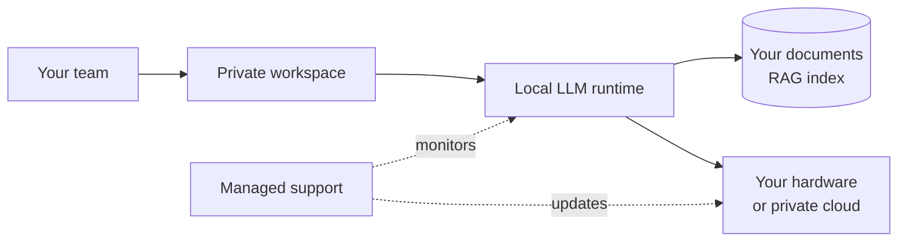

<picture>
  <source media="(prefers-color-scheme: dark)" srcset="./assets/ownllm-logo-horizontal-dark.svg">
  <source media="(prefers-color-scheme: light)" srcset="./assets/ownllm-logo-horizontal.svg">
  
</picture>

  

### Your AI. Your Infrastructure. Your Control.

**Private AI infrastructure, engineered for business.** 
Deploy, integrate and manage open-weight LLMs on-premise, in private cloud or hybrid.

 

[**Book a fit check**](#work-with-us) · [**Open reference material**](#open-reference-material) · [**Honest limits**](#honest-limits)

 

---

## What we do

We help teams run AI on hardware they own. No per-seat fees, no sensitive work pasted into tools you don't control, and a setup that someone is accountable for keeping healthy.

| | Service | What you get |
|:-:|---|---|
| **01** | **Local LLM Setup** | Hardware sizing, model selection, runtime install, a staff workspace with logins, backups, and training |
| **02** | **Private RAG** | Your own documents searchable by AI, with source citations and access rules |
| **03** | **Fine-Tuning** | Scoped tuning for a specific format, style or task, with a before/after evaluation |
| **04** | **Managed Services** | Monitoring, updates, security patches, backup checks and support |

 

## How it fits together

Everything between your team and the hardware runs inside an environment you control.

 

## How we work

| Step | What happens |
|:-:|---|
| **1. Assess** | Short assessment of your usage, data, hardware and goals |
| **2. Propose** | Fixed-price proposal with trade-offs stated plainly |
| **3. Deploy** | Remote setup on your hardware or private cloud, then validation |
| **4. Train** | Staff walkthrough and a one-page AI usage policy |
| **5. Support** | Optional monthly plan for updates, monitoring and fixes |

Delivery is remote and worldwide. Hardware is purchased by you, so you own it.

 

## Open reference material

We are building open, documented examples. All examples will use **synthetic data only**.

| Repository | Purpose | Status |
|---|---|:-:|
| `reference-stack` | A documented local LLM setup: runtime, chat interface, logins, backups | Planned |
| `rag-starter` | Private document Q&A with source citations | Planned |
| `setup-checklists` | Hardware sizing, security hardening and handover checklists | Planned |
| `when-not-to-self-host` | An honest guide to when hosted AI is the better choice | Planned |

> **Status:** early stage. Repositories will appear here as they are published. Open an issue if something is unclear or wrong.

 

## Honest limits

We would rather you know this before you buy.

- **Local models are strong for everyday work:** drafting, summaries, document Q&A and routine tasks.
- **Hosted frontier models still lead** on the hardest reasoning and coding tasks. We'll tell you plainly if that's what you need.
- **Under about 10 people** outside a sensitive sector, a subscription is usually cheaper than owning hardware.
- **Local is not automatically secure.** Access control, encryption and backups still have to be done properly, and they are part of our setup.
- **We don't claim compliance.** We design to your requirements, and your compliance advisor confirms what applies to you.

 

## Principles

| | |
|---|---|
| **Ownership** | You should understand and control your AI environment |
| **Practical engineering** | Systems that work in production, not impressive demos |
| **Transparency** | Trade-offs, limits and total costs stated up front |
| **Independence** | Avoid unnecessary vendor dependency without rejecting useful hosted services |
| **Privacy by design** | Architecture that respects your data requirements |

 

## Work with us

**Free 20-minute fit check.** We'll look at how your team uses AI today and tell you plainly whether a private setup makes sense, or whether hosted AI is the better choice.

**[Book a fit check](#)** &nbsp;·&nbsp; **[Email us](#)** &nbsp;·&nbsp; **[LinkedIn](#)**

 

---

OwnLLM Labs · Private AI on hardware you own · Remote delivery worldwide

