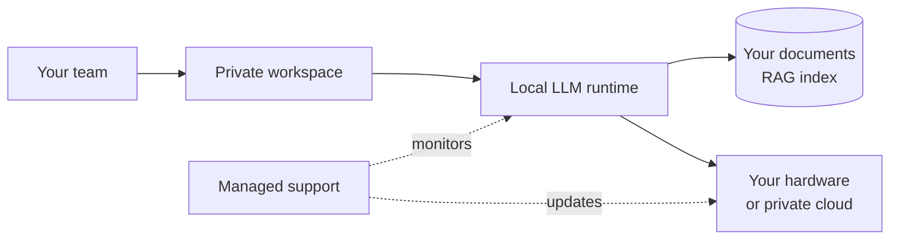

  

### Your AI. Your Infrastructure. Your Control.

**Private AI infrastructure, engineered for business.** 
Deploy, integrate and manage open-weight LLMs on-premise, in private cloud or hybrid.

 

[**What we do**](#what-we-do) · [**Why we exist**](#why-we-exist) · [**Who it's for**](#who-its-for) · [**Honest limits**](#honest-limits) · [**Work with us**](#work-with-us)

 

---

## What we do

We help teams run AI on hardware they own. We install a local LLM, build a private workspace for your staff, make your documents searchable by AI, tune a model where it genuinely helps, and keep it all running.

| | Service | What you get |
|:-:|---|---|
| **01** | **Local LLM Setup** | Hardware guidance, model selection, runtime install, a staff workspace with logins, backups and training |
| **02** | **Private RAG** | Your own documents searchable by AI, with source citations and access rules |
| **03** | **Fine-Tuning** | Scoped tuning for a specific format, style or task, with a before/after evaluation |
| **04** | **Managed Services** | Monitoring, updates, security patches, backup checks and support |

We deploy on customer-owned hardware, private cloud or a hybrid of both. Delivery is remote and worldwide. Setup is a one-time fee with an optional monthly support plan, and there are no per-seat charges.

 

## Who we are

OwnLLM Labs is an early-stage, engineering-led company, founded in 2026 by Rakibul and based in India. We are a very small team. We have not published customer case studies yet, and we will not invent any.

What we can promise is how we work: we explain trade-offs and limits before you buy, we document what we build, and we tell you plainly when hosted AI is the better choice for you.

 

## Why we exist

AI is becoming part of everyday work, and many teams use it without a clear plan for where their data goes or what it costs.

- Staff paste sensitive work into tools the organization doesn't control.
- Each person has a separate subscription, and the cost grows with every new seat.
- Teams that want control over their AI often lack the time or expertise to build and maintain it.

At the same time, open-weight models and self-hosted tools are now good enough for a large share of everyday work. The choice is no longer only "use a hosted service or go without."

| | |
|---|---|
| **Mission** | Make private, business-ready AI infrastructure accessible to organizations of different sizes. |
| **Vision** | A world where businesses can choose how their AI is deployed, where their data is processed and which models power their work. |

We are not against hosted AI. It is the right choice for many tasks and many teams. We help you choose deliberately, and often the answer is a mix of both.

 

## Who it's for

**A good fit:** organizations that have several people using AI regularly, handle internal, client or sensitive information, need control over where data is processed, or pay for many AI subscriptions or heavy API usage, and have a budget for setup plus someone to keep it running (or a support plan).

| Where we start | Typical uses |
|---|---|
| Small clinics and healthcare practices | Letters, summaries, administrative documents, searching internal procedures, always with human review |
| Software companies | Documentation, internal knowledge search, help with routine code |
| Agencies and consultancies | Research, content operations, searching client knowledge |
| Professional services and manufacturing | Document search, drafting, manuals and procedures |

**Not a good fit:** teams under about 10 people outside a sensitive sector, teams whose main use is hard coding or complex reasoning, anyone expecting exactly the quality of the best hosted models for free, or organizations with nobody to look after the system.

In regulated sectors such as healthcare and finance, deployment design and compliance need specialist review. We don't claim certifications or regulatory guarantees we don't hold.

 

## How we work

| Step | What happens |
|:-:|---|
| **1. Assess** | Short review of your usage, data, hardware and goals |
| **2. Propose** | Fixed-price proposal with trade-offs stated plainly |
| **3. Deploy** | Remote setup on your hardware or private cloud, then validation |
| **4. Train** | Staff walkthrough and a one-page AI usage policy |
| **5. Support** | Optional monthly plan for updates, monitoring and fixes |

 

## Honest limits

We would rather you know this before you buy.

- **Local models are strong for everyday work:** drafting, summaries, document Q&A and routine tasks.
- **Hosted frontier models still lead** on the hardest reasoning and coding tasks. We'll tell you plainly if that's what you need.
- **Under about 10 people** outside a sensitive sector, a subscription is usually cheaper than owning hardware.
- **Local is not automatically secure.** Access control, encryption and backups still have to be done properly, and they are part of our setup.
- **We don't claim compliance.** We design to your requirements, and your own advisers confirm what applies to you.

 

## Principles

| | |
|---|---|
| **Ownership** | You should understand and control your AI environment |
| **Privacy** | Architecture that respects your data requirements |
| **Practical engineering** | Systems that work in production, not impressive demos |
| **Transparency** | Trade-offs, limits and total costs stated up front |
| **Independence** | Avoid unnecessary vendor dependency without rejecting useful hosted services |

 

## Open reference material

We are building open, documented examples. All examples will use **synthetic data only**.

| Repository | Purpose | Status |
|---|---|:-:|
| `reference-stack` | A documented local LLM setup: runtime, chat interface, logins, backups | Planned |
| `rag-starter` | Private document Q&A with source citations | Planned |
| `setup-checklists` | Hardware sizing, security hardening and handover checklists | Planned |
| `when-not-to-self-host` | An honest guide to when hosted AI is the better choice | Planned |

 

## Work with us

**Free 20-minute fit check.** We'll look at how your team uses AI today and tell you plainly whether a private setup makes sense, or whether hosted AI is the better choice.

**[Book a fit check](#)** &nbsp;·&nbsp; **[Email us](#)** &nbsp;·&nbsp; **[LinkedIn](#)**

 

---

OwnLLM Labs · Private AI on hardware you own · Remote delivery worldwide

